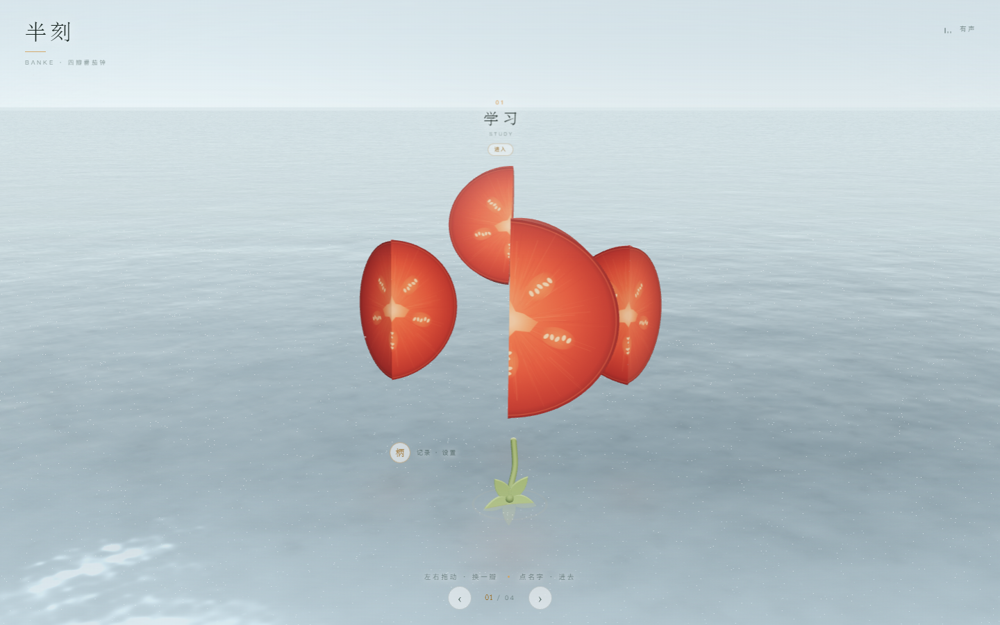
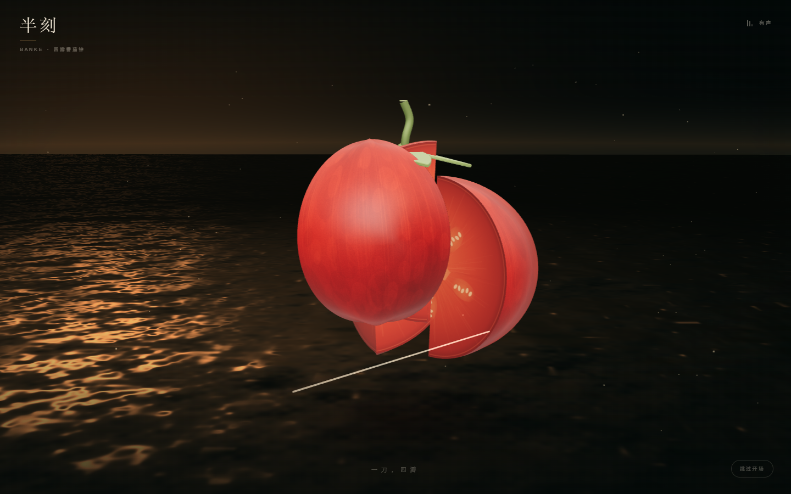
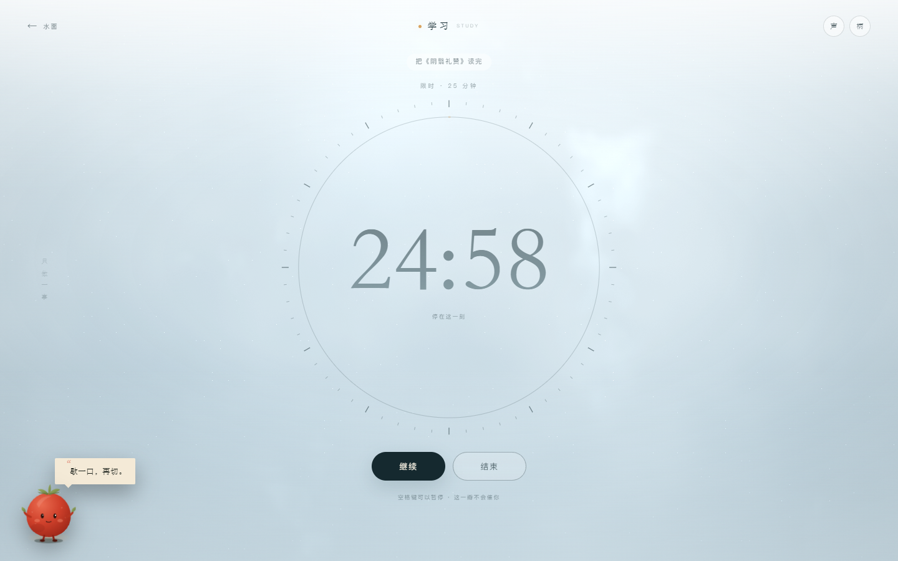
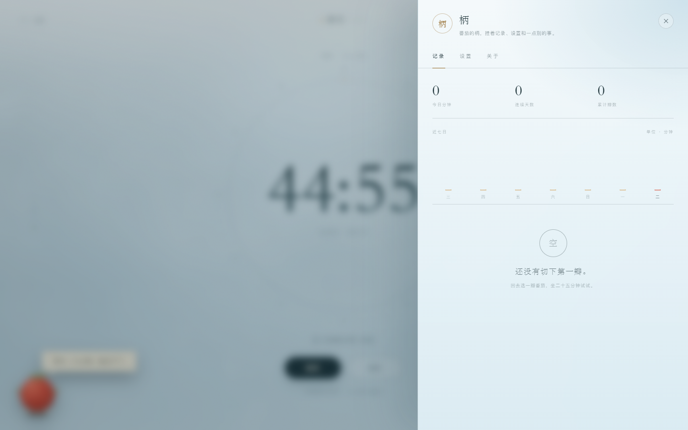
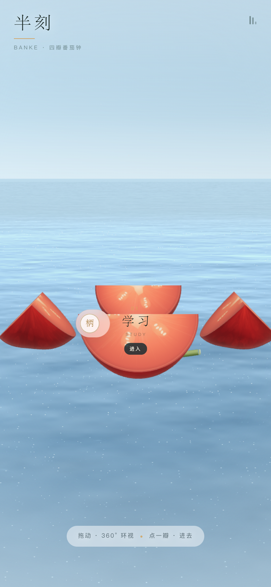

# 半刻 · 四瓣番茄钟

> 把一颗番茄切成四瓣，把一天切成几段。  
> 不追着你跑，只在水边替你数着。

半刻是一个离线优先的番茄钟：开场是一颗带柄的番茄被切成四瓣，四瓣分别对应**学习 / 工作 / 阅读 / 静心**；切下来的**柄**落在水面上，挂着记录、设置与关于。每一瓣都有输入、限时或正计时、完成记录，以及一只由半颗番茄变成的小小灵宠。





| 专注 | 记录 | 手机 |
| --- | --- | --- |
|  |  |  |

## 现在能做什么

- **一刀四瓣的 3D 开场**：Three.js 程序化番茄、透明水面、水花粒子、落水的柄；鼠标 / 手指拖动可转视角。
- **四个版块**：学习、工作、阅读、静心，各有各的提问与配色。
- **输入可跳过**：可手动跳过，也可以在设置里默认跳过。
- **限时 / 不限时**：限时可随时轻点数字切到正计时，看自己已经坐了多久。
- **灵宠番茄人**：本地语气规则，会在开始、暂停、过半、完成、放弃时说话；设置里预留 OpenAI 兼容接口。
- **记录**：今日分钟、连续天数、累计瓣数、近七日柱图、按天分组的每一瓣。
- **完全离线**：单文件 HTML，无需服务器；记录只在 localStorage。
- **声音**：WebAudio 合成的刀声、水花、钵音与水面环境音，没有外部音频文件。
- **后续接入点**：音乐、系统状态、动态背景、远端灵宠都已留好接口，见 [架构说明](docs/ARCHITECTURE.md)。

## 两个版本

### 1. 电脑本地版（现在就能用）

**双击根目录的 `半刻.html`**（或 `启动半刻.cmd`）即可。浏览器打开，无需安装、无需联网。

- 也可以直接双击 `dist/index.html`，是同一个单文件。
- 文件很小（约 1.2 MB），全部资源都内联在里面。
- 想要独立窗口 / exe：用 GitHub Actions 的 `build-desktop` 工作流（见下），或在有 Node 的电脑上：

```bash
npm install
npm i -D electron@33.2.0 electron-builder@25.1.8
npm run dist:win
```

### 2. 手机 APK（GitHub Actions 构建）

仓库里已经带了完整的 Capacitor Android 工程和 `build-android` 工作流，但**没有提交签名后的 APK**。推送到 GitHub 后：

1. 打开仓库的 **Actions → build-android → Run workflow**（推到 `main` 也会自动触发）。
2. 等 2–4 分钟，进入这次运行，下载 **Artifacts → banke-android-debug**。
3. 解压得到 `app-debug.apk`，传到手机安装；首次安装需要允许「安装未知来源应用」。
4. 桌面图标叫「半刻」，启动图是番茄切面。

> 这是 debug 签名，适合自己和朋友用。要发布到应用商店，需要配置 release 签名，步骤见 [部署说明](docs/DEPLOY.md#release-签名可选)。

也可以把项目推到 GitHub 后，在 **Actions → deploy-web** 自动发布到 GitHub Pages，得到一个在线地址（手机浏览器也能打开，并可「添加到主屏幕」）。

## 开发

需要 Node.js 20+。

```bash
npm install
npm run dev      # 本地开发（Vite）
npm run build    # 生成 dist/index.html 与根目录 半刻.html
npm run android  # 构建网页并同步到 android/
```

构建入口是 `tools/bundle.mjs`：Rollup + SWC + terser，全程在 Node 进程内完成，不依赖 esbuild 子进程，CI 更稳。产物是真正的单文件，`file://` 直接打开也能跑。

截图验收：

```bash
npm run build
npm run shot     # 需要本机 Chrome；输出到 tools/shots
```

## 目录

```text
src/
  core/         计时、状态、声音、灵宠语气、接入插槽
  three/        番茄 / 水面 / 水花 / 蒂 / 镜头
  components/   开场、专注、柄（记录 / 设置 / 关于）、灵宠
  styles/       夜池、旧纸、番茄红的设计系统
android/        Capacitor Android 工程（可直接 Actions 构建）
electron/       桌面壳
tools/          构建、图标生成、截图脚本
docs/           架构、部署、截图
```

## 数据与隐私

- 没有账号，没有云端，没有广告。
- 记录、设置、灵宠接口配置都只存在当前设备的 `localStorage`（`banke.state.v1`）。
- 设置里可以导出 / 导入 JSON，也可以一键清除。
- 如果启用了远端灵宠，仅会把当前事件（如「刚完成一次工作专注」）发给你的接口；失败时自动退回本地语气。

## 已知边界

- 音乐播放、系统状态、自定义动态背景这一版**没有实现**，只留了类型与注册表；这是刻意的，避免半成品入口。
- APK 是 debug 签名；release 签名步骤写在部署文档里。
- 灵宠远端接口需要 HTTPS 且允许浏览器跨域（CORS）。
- 单文件版的数据跟着「文件所在浏览器」走，换浏览器 / 清理站点数据会丢；重要记录请导出 JSON。

## 技术与致谢

- React 18 + Three.js + React Three Fiber + Zustand + Framer Motion
- Capacitor 6（Android）+ Electron（Windows）
- 所有番茄、水面、蒂、粒子均为程序化生成；声音由 WebAudio 合成；字体取自系统。
- 为长时间坐着的人做的一颗番茄。
